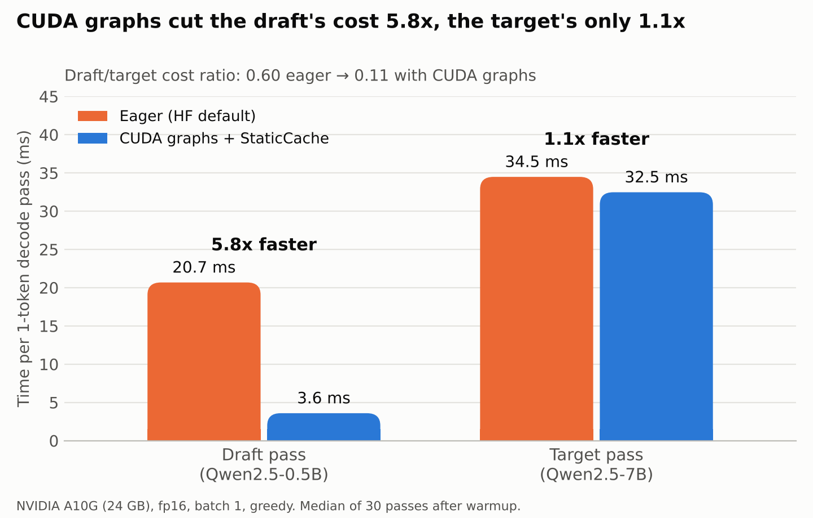

# Profiling speculative decoding on a single GPU

Where does the time go when a small draft model and a large target model run speculative
decoding (SD) on the **same GPU**? These scripts measure it step by step, from an
end-to-end baseline down to per-layer timing, handoff costs, framework overhead, and finally
a custom SD loop with both models on CUDA graphs, and the two models running concurrently.

**Setup:** NVIDIA A10G (24 GB, AWS g5.xlarge) · target `Qwen/Qwen2.5-7B-Instruct` · draft
`Qwen/Qwen2.5-0.5B-Instruct` · fp16 · batch 1 · greedy · transformers 5.20.

## Steps

| Script | Question | Output on A10G |
|---|---|---|
| `step1.py` | Does HF assisted generation speed things up? | [`results/a10g/step1.txt`](results/a10g/step1.txt) |
| `step2.py` | How much does each pass cost, what happens in a round, and does fixing *k* (draft tokens per round) help? | [`results/a10g/step2.txt`](results/a10g/step2.txt) |
| `step3.py` | Per-layer timeline of one decode pass, for each model | [`results/a10g/step3.txt`](results/a10g/step3.txt) |
| `step4.py` | Cost of every draft↔target handoff (KV rollback, hidden states, logits, tree mask) | [`results/a10g/step4.txt`](results/a10g/step4.txt) |
| `step5.py` | Is the draft GPU-bound or overhead-bound? (eager vs StaticCache vs CUDA graphs) | [`results/a10g/step5.txt`](results/a10g/step5.txt) |
| `step6.py` | Custom SD loop with both models on CUDA graphs: real speedup vs *k*, per-round time split, overlap upper bound | [`results/a10g/step6.txt`](results/a10g/step6.txt) |
| `step7.py` | Draft and target verify running **concurrently** on separate streams: slowdown of each, makespan vs serial, stream priorities, SM clock/power | *not yet run* |

## Findings so far

1. **HF assisted generation is slower than the target alone:** 0.61–0.80x (adaptive *k*),
   at best 0.95x with a fixed *k* = 2–3. The draft costs 0.64 of a target pass even though
   it is 14x smaller.
2. **The draft is overhead-bound, the target is GPU-bound.** The GPU is busy ~11% of the time
   during draft passes vs ~62% during target passes (profiler, approximate). CUDA graphs cut a
   draft pass from 20.7 → 3.6 ms (5.8x) but a target pass only 34.5 → 32.5 ms (1.1x).
3. **Handoffs are cheap.** Every draft↔target handoff measured in step4 costs < 1% of a
   target decode step.
4. **Verification is nearly free in width:** a 5-token target pass costs 1.05x a 1-token pass.
5. **With both models on CUDA graphs, SD works:** 2.71x at *k* = 4 (81% of drafts accepted) and
   2.86x at *k* = 6 over the graphed target alone (31.2 tok/s), with output identical to plain
   greedy decoding. A round at *k* = 6: draft 36%, verify 56%, accept + rollback 8%.



## Run

```bash
python -m venv venv && source venv/bin/activate
pip install -r requirements.txt   # + nvidia-ml-py for step7 Part C
python step1.py 2>&1 | tee step1.txt     # likewise for step2 ... step7
```

Needs a CUDA GPU with ≥ 24 GB. On a 16 GB-RAM machine the 7B model is loaded straight to the
GPU (`device_map="cuda"`). `step2.py` writes `trace.json` (PyTorch profiler; open at
https://ui.perfetto.dev). `step5.py` and `step6.py` compile CUDA graphs on first use, which
takes a few minutes.

Notes: the 0.5B draft's vocabulary (151936) is padded to the 7B's (152064) with
`resize_token_embeddings` so HF treats them as sharing a tokenizer. `step6.py` skips this
because it only compares token ids. fp16 near-ties can make SD and plain decoding differ in
a few tokens.
