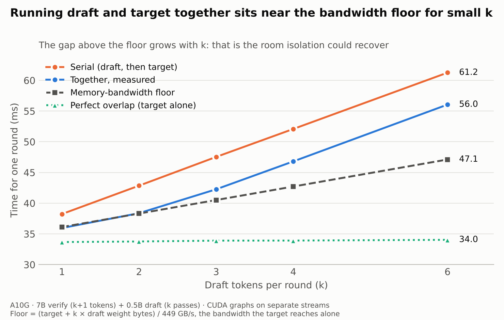

# Results and figures

**Setup:** NVIDIA A10G (24 GB, AWS g5.xlarge) · target `Qwen/Qwen2.5-7B-Instruct` · draft
`Qwen/Qwen2.5-0.5B-Instruct` · fp16 · batch 1 · greedy · transformers 5.20.

## Steps

| Script | Question | Output on A10G |
|---|---|---|
| [`step1.py`](../src/step1.py) | Does HF assisted generation speed things up? | [`step1.txt`](../results/a10g/step1.txt) |
| [`step2.py`](../src/step2.py) | How much does each pass cost, what happens in a round, and does fixing *k* (draft tokens per round) help? | [`step2.txt`](../results/a10g/step2.txt) |
| [`step3.py`](../src/step3.py) | Per-layer timeline of one decode pass, for each model | [`step3.txt`](../results/a10g/step3.txt) |
| [`step4.py`](../src/step4.py) | Cost of every draft↔target handoff (KV rollback, hidden states, logits, tree mask) | [`step4.txt`](../results/a10g/step4.txt) |
| [`step5.py`](../src/step5.py) | Is the draft GPU-bound or overhead-bound? (eager vs StaticCache vs CUDA graphs) | [`step5.txt`](../results/a10g/step5.txt) |
| [`step6.py`](../src/step6.py) | Custom SD loop with both models on CUDA graphs: real speedup vs *k*, per-round time split, overlap upper bound | [`step6.txt`](../results/a10g/step6.txt) |
| [`step7.py`](../src/step7.py) | Draft and target verify running **concurrently** on separate streams: slowdown of each, makespan vs serial, stream priorities, SM clock/power | [`step7.txt`](../results/a10g/step7.txt) |

## Findings

1. **HF assisted generation is slower than the target alone:** 0.61–0.80x (adaptive *k*),
   at best 0.95x with a fixed *k* = 2–3. The draft costs 0.64 of a target pass even though
   it is 14x smaller.
2. **The draft is overhead-bound, the target is GPU-bound.** The GPU is busy ~11% of the time
   during draft passes vs ~62% during target passes (profiler, approximate). CUDA graphs cut a
   draft pass from 20.7 → 3.6 ms (5.8x) but a target pass only 34.5 → 32.5 ms (1.1x).
3. **Handoffs are cheap.** Every draft↔target handoff measured in step4 costs < 1% of a
   target decode step.
4. **Verification is nearly free in width:** a 5-token target pass costs 1.05x a 1-token pass.
5. **With both models on CUDA graphs, SD works:** 2.71x at *k* = 4 (81% of drafts accepted) and
   2.86x at *k* = 6 over the graphed target alone (31.2 tok/s), with output identical to plain
   greedy decoding. A round at *k* = 6: draft 36%, verify 56%, accept + rollback 8%.
6. **Running draft and target concurrently mostly hits the memory-bandwidth wall.** The draft slows
   2.1–3.5x, the target only 1.07–1.15x. For k ≤ 2 the concurrent round already matches the
   bandwidth floor (target + k draft weight reads at the 449 GB/s the target reaches alone); the gap
   above the floor grows with k (4 ms at k = 4, 9 ms at k = 6). Nsight shows the draft's kernels
   run 2.6x longer while the target runs (1.02x when it is idle), led by tiny 1–2-block elementwise
   kernels, plus extra waiting to start. No clock throttling (1710 MHz, 178 W of 300 W); stream
   priorities had no measurable effect.

## Figures

Regenerate with `python scripts/plot_cuda_graphs.py` and `python scripts/plot_overlap_floor.py`
(run from the repo root).

## Notes

The 0.5B draft's vocabulary (151936) is padded to the 7B's (152064) with
`resize_token_embeddings` so HF treats them as sharing a tokenizer. `step6.py` skips this
because it only compares token ids. fp16 near-ties can make SD and plain decoding differ in
a few tokens.
